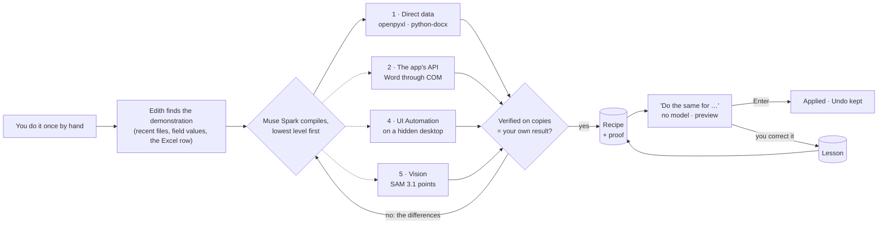
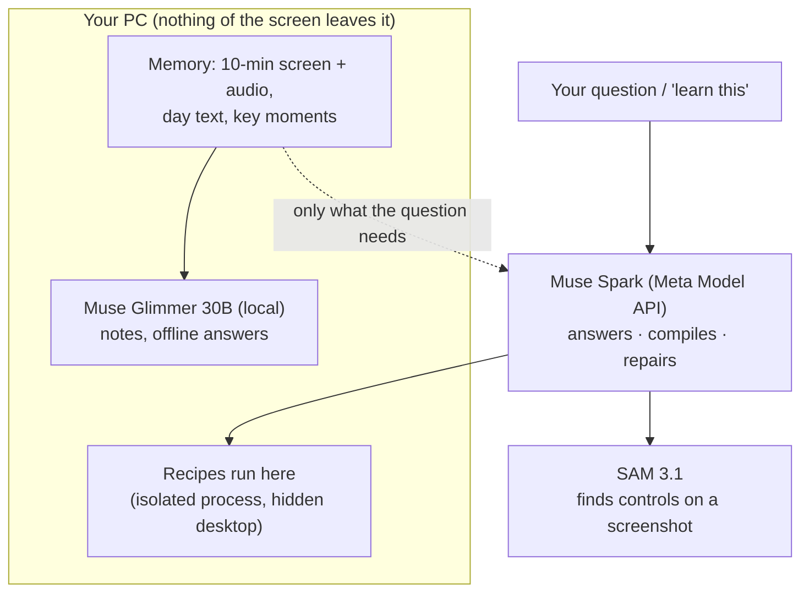

# Edith

**Push the Frontier** — Every week we redo the same small computer tasks by hand (a letter per client, an
invoice per row), because teaching a computer to do them still takes a programmer.

**Show it once. Edith does the next ones.**

Built for the Meta Global AI Developer Hackathon 2026 (Indie Developer track).

Do a task once by hand — a Word letter from a row of an Excel sheet, an invoice typed into a
desktop app — and tell Edith *"learn this"*. Muse Spark compiles what you did into a small
program at the **lowest level that gives exactly your result**, verifies it on copies against
your own work, and keeps it as a **recipe**. Next time, *"do the same for Panadería Ñandú"* runs
in half a second, as a preview you confirm with Enter. Correct a result once and Edith keeps
the **lesson**. It also remembers the last ~10 minutes of your screen and audio, so you can ask
what just happened. *Your screen never leaves your PC. Only what you ask goes to the cloud.*





## How we use Meta's models

| Model | Where | Role in Edith |
|---|---|---|
| **Muse Glimmer 30B** (open weights, Apache-2.0; 2-bit GGUF via llama.cpp) | On the PC, ~2 GB VRAM, low priority | Block summaries and key moments of the memory; answers when offline, out of budget or in "local only"; nothing of the continuous capture is ever sent to the cloud |
| **Muse Spark** (`muse-spark-1.3`, Meta Model API) | Cloud, only when the user asks | Answers questions with the cheapest context that can answer; **compiles recipes** into programs (levels 1, 2, 4, 5); turns a correction into a lesson; **replans** a recipe that failed twice; labels the controls SAM found |
| **SAM 3.1** (`sam-3.1`, Meta Model API) | Cloud, when a recipe needs eyes | Level 5: finds the fields and buttons of an app on a screenshot of the hidden desktop; also locates elements for the older form machines |

## Research Edith builds on

| Paper | Institution | Venue | What Edith takes from it |
|---|---|---|---|
| AXIS: API-first LLM-based agents | Microsoft | ACL 2025 | Prefer an API over clicking: the cascade tries direct data and the app's API before any UI |
| ASI: Inducing programmatic skills for agentic tasks | Carnegie Mellon University | COLM 2025 | A demonstration becomes a **program**, kept only after it is verified |
| SkillWeaver: web agents discover and hone skills | The Ohio State University, CMU et al. | arXiv 2025 | Skills as reusable code that is tested before it is kept and honed when it fails (verification, lessons, escalation, web machines that repair themselves when the site changes); unlike SkillWeaver, Edith never explores a site on its own: every skill comes from the user's demonstration |
| Beyond Browsing: API-based web agents | Carnegie Mellon University | Findings of ACL 2025 | APIs and UI as alternatives to choose from per task (level 3 is planned) |
| UFO2: the desktop AgentOS | Microsoft | TMLR | UI Automation-first desktop control and a separate desktop so the user is not disturbed (levels 4-5) |
| AppAgentX: evolving GUI agents | Westlake University et al. | arXiv 2025 | Repeated action sequences become one higher-level action ("¿Guardo esto como receta?") |
| Mobile-Agent-E: self-evolving assistant | UIUC, Alibaba | NeurIPS 2025 | Two long-term memories: shortcuts (recipes) and tips (lessons) |
| OS-Copilot: generalist computer agents with self-improvement | Shanghai AI Laboratory et al. | ICLR 2024 (workshop) | Tools the agent writes for itself, checked and kept for later |

Demo video: coming Nov 4.

## The interface

Edith stays out of the way. Rule: if something is not needed right now, it is not shown.

- **At rest** it is a single 40 px soft dot, always on top and draggable, with no text or
  icon. The dot's center is the only status indicator: gray when idle, a dimmer gray while
  the memory is paused, the accent color while thinking or acting (a soft fade, never an
  animation). The status dot and the raised circle are drawn from the same rectangle, so
  they share one geometric center, with equal margins all round for the shadows.
- **Ctrl+Alt+E** (a global shortcut) opens and closes the panel from any app, with the
  cursor in the text field. It can be changed in the options: *"Press the combination…"*,
  a modifier plus a key is required, Esc cancels, a combination another app already uses is
  refused (the old one stays), and *Default* restores Ctrl+Alt+E. It is saved and applied
  at once.
- **Click** the dot and it opens into a panel with one text field and the answer under it.
  The audio and options glyphs sit inside the field's right end, like the icons of a search
  field, and fade in only while the mouse is over the panel; the options open as one quiet
  column (Activity, Pause memory, Local only, Presentation mode; the shortcut; Delete
  everything, Quit). Esc or a click elsewhere closes it back into the dot.
- **It talks like a person.** "Hi", "thanks" or "what is recursion?" get a short, natural
  answer with nothing of the screen sent. A doubt about the screen right now ("what does this
  error mean?", "what's missing here?") is answered from the current screen. "How do I automate
  this?" gets a short guide tailored to what is open (the spreadsheet, the form). The memory is
  used only when the question is about what happened; when it is unclear, the model may ask for
  it with a hidden token and Edith asks again with the memory.
- **Answers stream** in token by token, typeset for reading (generous line height, Markdown
  bold and lists). The panel shows nothing the user did not ask for: what was sent and its
  cost are kept in the ledger and the Activity view (`[ui] show_details = true` puts them
  back under each answer).
- **Edit from memory** (the star feature): *"put in my notes what the teacher explained"*,
  *"reply to this email with the data I saw earlier"*. Edith takes the field you were in
  when you opened it (Ctrl+Alt+E, or a click on the dot, which does not steal the focus),
  finds the content in its memory and prepares the text. It never writes directly: the
  panel shows a preview, new text in the accent and removed text struck through in gray,
  *Enter to apply · Esc to discard*, and under it *"Based on: [thumbnail] class audio · 4 min
  ago"*. Enter pastes it into the field (your clipboard is saved and restored) and checks it
  is really there. **"Undo Edith's last edit"** stays in the panel; it uses the app's own undo,
  checks the text is back, and refuses if you changed the text after Edith's edit.
- **Presentation mode** (off by default, Ctrl+Alt+P or the options): a soft accent outline
  around the field Edith is writing into, for demos. It is the only thing Edith ever draws
  over other apps, and it never takes the focus or a click.
- **Key moments** (at most 3, one line each, the time quiet on the right) appear under the field when
  there is no answer on screen: a slide change, a date or deadline, a task, "this is in the
  exam". A click asks about that moment. There are no pop-ups.
- **Agent mode** draws nothing on the screen: no overlays, no outlines. Progress is one line
  of gray text in the panel (*"Writing row 3 of 29 in 127.0.0.1:8765…"*). Before sending,
  the panel shows what will be sent (rows, totals, skipped rows); Enter sends, Esc cancels.
- **Activity** opens a separate view with RAM, VRAM, the memory's activity over the last
  10 minutes, answer time (cloud and local) and the daily cloud cost (this month's total as
  the big number): the number large, a 1.75 px accent sparkline under it for the trend, a faint
  fill, no axes, grid or legend; the exact value is in a tooltip under the mouse.
- **Soft UI**: one flat background color shared by the panel and the buttons; relief comes
  only from two soft shadows (light up-left, dark down-right, same offset and blur), real
  Gaussian blurs tinted with the background's own hue, plus a one-pixel rim of light along the
  top edge and a faint sheen; the field is pressed in gently; the closed dot has a centered,
  symmetric glow instead. Every window keeps a
  transparent margin of offset + blur on all four sides, so no shadow is ever cut. No borders
  or dividers, 16-24 px corners, one accent color, everything else gray.
- **Type and color**: one typeface, Source Serif 4 (bundled, SIL OFL), 400 for text and 600
  for titles and large numbers; 14 px text, 12 px secondary, 28 px large numbers. Text is
  #1A1B1E (light) / #F2F3F5 (dark), secondary text the same at 62 % / 60 %; the accent is
  #5B7CFA (light) / #7AA7FF (dark). Every text color reaches 4.5:1 on its background (a test
  checks it): in the light theme 60 % gave 4.24:1, so secondary text is 62 %, and accent-colored
  text uses #2A55F9 (the same hue, 4.6:1) while the dot and the lines keep #5B7CFA (3.0:1).
- **Centered**: the dot and its circle come from one rectangle (one geometric center). The open
  panel has the same 24 px inner margin on all four sides, everything under the field starts
  on the field's text axis, and it opens centered on the dot, with the field where the dot was,
  moved back inside the screen near an edge.
- **Light and dark** follow the Windows app theme live, without restarting: every color is
  a variable with a light and a dark set, and a theme change fades over 250 ms.

## Results (real runs, Nov 3-4, 2026)

Every number below comes from a script in `scripts/` (raw rows in `results/*.csv`). Muse Spark
and SAM 3.1 are the real Meta Model API; Word, the desktop app and the portal are real; the
data is fictitious and the memories are built in isolated Edith homes, never the user's.

**Demo-checks** — the whole flow, from nothing, several times in a row:

| Check | What it goes through | Result |
|---|---|---|
| `demo_check.py` | learn (Excel -> Word) -> variation in < 3 s -> Enter -> Undo -> ambiguous client -> two letters + Esc -> lesson from the edited preview -> applied by itself -> "corrige: ..." -> applied -> Discard -> a forced bug replanned by Muse Spark -> replan forced to fail: down to level 2 -> "¿Guardo esto como receta?" -> desktop form at level 4 (dry runs, Enter, Undo) -> forced to level 5 with SAM 3.1 -> preview -> Esc | **5/5 runs, 16/16 steps each** (alone on the machine; 36 min) |
| `memory_check.py` | capture -> temporal question -> edit from memory -> apply in a test window -> undo, with the API / without internet (local Muse Glimmer) / with the budget reached | 3/3 modes OK |

**Recipes, by level** (the demo letter and the demo desktop form):

| Level | How it runs | Compile (Muse Spark, verified) | One run |
|---|---|---|---|
| 1 · direct data | openpyxl + python-docx in the isolated process | 25-51 s, $0.017-0.027, 1st attempt in 15/15 demo-check runs | **0.42-0.66 s** (replay of the demo letter) |
| 2 · the app's API | Word through COM, invisible | 3/3 on the 1st attempt after the positional-arguments fix | ~5 s (Word starts) |
| 3 · the web | the site's own request / headless browser with the user's session | the workshop's machine (verified on a temporary database) | network: 28 invoices in 0.3 s (Phase 5) |
| 4 · UI Automation | controls by name on the hidden desktop | ~70 s (3 dry runs) | 13-17 s (PowerShell + UIA start) |
| 5 · SAM 3.1 | points found on a screenshot of the hidden desktop | ~57 s | 0.8-2.2 s |

**Coverage mini-benchmark** (`coverage_bench.py`): 20 student tasks (16 Word documents from a
sheet and a template — certificates, receipts, letters, a grade report that needs an average...
— and 4 invoices in the desktop app), each run twice: the first time in free mode (Muse Spark plans; the successful run is induced
as a recipe), the second time as that recipe.

| Run | Correct | Avg time per task |
|---|---|---|
| 1 · free mode (then induced as a recipe) | **20/20** | 17.7 s (Word 10-21 s, desktop app 25-29 s) |
| 2 · the induced recipe | **20/20** | **3.6 s** (Word 0.6-1.9 s at level 1, desktop app 13.7 s at level 4) |

**30 invoices into a desktop app, five ways** (`invoices_bench.py`; correct = exactly what the
person types; one row has an empty amount):

| Way | Correct | Time per invoice | Cost per invoice |
|---|---|---|---|
| (a) click-by-click agent: Muse Spark picks every action | 2/30 | 55.2 s | $0.0106 |
| (b) Muse Spark writes a program from a text description (no demonstration) | 1/30 | 16.4 s | $0.0007 |
| (c) **level-4 recipe from ONE invoice typed by hand** | **30/30** | 16.3 s | **$0** (compiled once: 105 s, $0.028) |
| (d) **level-5 recipe** (SAM 3.1 points) | **30/30** | **0.99 s** | **$0** (compiled once: 56 s, $0.029) |
| (e) the app changes (v2: "Amount" renamed and moved) -> escalation repairs it | **30/30** | 0.96 s | $0.002 (repair 158 s, $0.061 total) |

Why (a) and (b) fail: without a demonstration they type dates as `2026-10-08` instead of
`08/10/2026` and amounts as `2697` or `4,216.96` instead of `2697.00` / `4216.96` — the record
is saved, but not the way the person writes it. The demonstration is what carries those
conventions. (This run shared the machine with the other benchmarks, so the times of (a)-(c) are
upper bounds.)

**Memory** (`memory_check.py`, `benchmark.py`; screenshots and memories are synthetic and clean,
so these are easy cases):

| Measure | Result |
|---|---|
| 20 questions about screenshots (errors, charts, tables, receipts...) | 20/20, 6.5 s avg, $0.055 total |
| 10 edit-from-memory scenarios (notes, replies to an email) | 10/10, 4.7 s to the preview |
| Key moments vs 30 lines labelled by hand (filter, no model) | precision 94 %, recall 100 % |
| Temporal question with the API / local only | 3.3 s ($0.0025) / 45-56 s ($0) |
| **Real cost of 10 test questions** (chat, memory, screen, automation) | **$0.026 total**, 4.1 s avg, 10/10 right |

**Cost.** Measured unit costs: a question $0.0008-0.0052 (avg $0.0026); compiling a recipe,
learning a lesson or replanning ~$0.017 per call; running a recipe $0. A day with 20 questions,
one new recipe and two corrections costs about **$0.11** (estimate from those unit costs; the
monthly limit stays at $10 with a warning at 80 %).

## Privacy and security

- **Local:** the 10-minute screen/audio buffer, the day's text, key moments, conversations,
  recipes and lessons — all in `buffer/` and `state/` on the PC (git-ignored). Muse Glimmer runs
  locally (llama.cpp on 127.0.0.1).
- **To the API, only when you ask:** the question with the cheapest context that answers it; for a
  recipe, the text of the files it uses (or a form's fields; one screenshot of the app on the
  hidden desktop for level 5). Running a recipe sends nothing. Network audit: 90 s of recording
  opened 0 outside connections; a question opened exactly one, to the Meta Model API.
- **Never recorded:** the keyboard (in any mode), password fields, excluded apps; Edith's own text
  field is not memory.
- **Confirmations:** every recipe and free-mode run is a preview first (Enter applies, Esc
  discards, Undo restores from a backup); a site's records cannot be undone, and the panel says so;
  a CAPTCHA or two-step code is left to you.
- **Isolation:** programs run in a separate process (AST whitelist + audit hook: no writes outside
  their folder, no programs, no network, no keys), levels 4-5 on a separate Windows desktop.
  Tokens live in the Windows Credential Manager. **Ctrl+Alt+Q** stops everything at once.
- Details: [docs/PRIVACY.md](docs/PRIVACY.md), [docs/NETWORK_AUDIT.md](docs/NETWORK_AUDIT.md).

## Scope and limitations

- Recipes are row-of-a-sheet tasks (one document or one form per row). Free mode handles other
  file tasks (e.g. a filtered CSV) but only row tasks are induced as recipes.
- Desktop levels 4-5 were shown on one demo app (PowerShell WinForms); real apps vary in how
  accessible their controls are. Level 4 runs take 13-17 s because each starts PowerShell and UI
  Automation. Free mode in desktop apps uses UI Automation only (SAM is used for level-5 recipes).
- Level 3 was exercised on the local demo portal; real sites with sign-in were not tested here.
  Edith learns a site only from the user's own demonstration on it: it does not explore sites on
  its own and does not build APIs from a site's internal traffic.
- Local answers (Muse Glimmer, 6 GPU layers, ~2 GB VRAM) take 25-56 s; the cloud takes 2-7 s.
- Lessons trigger (d) (discard, then do it your own way) is built and tested but off by default.
- The memory benchmarks use synthetic, clean screenshots and memories.

## Setup (Windows 11, Python 3.12)

```powershell
py -3.12 -m venv .venv
.venv\Scripts\python -m pip install -e .
copy .env.example .env   # then put your Meta Model API key in MODEL_API_KEY
# Optional local model (~13 GB): llama.cpp and Muse Glimmer 30B (2-bit) with its vision projector
winget install ggml.llamacpp
.venv\Scripts\hf download unsloth/Muse-Glimmer-30B-GGUF Muse-Glimmer-30B-UD-Q2_K_XL.gguf mmproj-kquant.gguf
```

## Usage

In the panel (click the dot or press Ctrl+Alt+E):

| You say / press | Edith |
|---|---|
| a task done once by hand, then **"Edith, aprende esto"** / **Ctrl+Alt+R** | compiles and verifies a recipe |
| **"haz lo mismo para Panadería Ñandú"**, "para Ñandú y Acuña", "para todos" | runs the recipe: preview, Enter, Undo |
| **Correct** under a preview, or **"corrige: …"** | learns a lesson, applied from then on |
| an order with no recipe ("haz un CSV con…", "registra en Northwind…") | free mode, then "Aprendí esta tarea" |
| a question ("¿qué dijo el profe del examen?") | answers from the last minutes / the day |
| **Ctrl+Alt+Q** | stops everything at once |

Demo files: `python demo/make_letters.py` (template + invoices) and
`powershell -File demo/desktop/northwind.ps1 -Store demo/data/northwind.jsonl` (the desktop app).
Evidence: `scripts/demo_check.py`, `scripts/memory_check.py`, `scripts/benchmark.py`,
`scripts/coverage_bench.py`, `scripts/invoices_bench.py`, `scripts/quant_bench.py`.

From a console:

```powershell
.venv\Scripts\edith-ui                          # Edith on screen (no console window)
.venv\Scripts\edith                             # the same, from a console
.venv\Scripts\python -m edith run              # memory only, Ctrl+C to stop
.venv\Scripts\python -m edith ask "what was the video about?"
.venv\Scripts\python -m edith ask "..." --dry-run   # show the context, no model call
.venv\Scripts\python -m edith ask "..." --local     # answer with the local model only ($0)
.venv\Scripts\python -m edith cost                  # session and month cost
.venv\Scripts\python -m edith status
.venv\Scripts\python -m edith do "what I did 3 minutes ago, do it with the rest"
.venv\Scripts\python -m unittest discover -s tests       # tests
.venv\Scripts\python scripts\measure_tokens.py           # token measurements (counts only)
```

# Under the hood

## How it works: memory (Phase 1)

```
 screen (mss, every 2 s; 0.5 s after a click) ──► change detection ──► buffer/frames/*.jpg ─┐
 foreground window (ctypes) ─────────────────────────────────────────────────────────────────┤
 mouse clicks (low-level MOUSE hook) ──► UIA element under the click ────────────────────────┤
 focused text field (UIA ValuePattern, never passwords) ──► value once it settles ───────────┤
 speakers (WASAPI loopback, 15 s blocks) ──► silence gate ──► faster-whisper (CUDA int8) ────┤
                                                                                             ▼
                                              buffer/timeline.jsonl (rolling 10-minute window)
                                                                                             │
 window text after each change (UI Automation, no model) ─────────────────────────────────┤
                                                                                             │
 local model (Muse Glimmer, low priority) ──► key moments + block summaries ◄────────────────┤
                                                                                             │
 a question ──► text first (+ ≤3 screenshots if it needs to see) ──► Muse Spark ─────────────┘
              └─► local only / offline / monthly limit ──► Muse Glimmer ("Answered locally")
```

- **Capture** saves a frame only when the screen changed (>2% mean difference) or every 30 s.
  After a click it looks every 0.5 s for 3 s, so the result of each action is caught.
- **Actions**: each click is logged with its position and the UI Automation element under
  it (type, name, rectangle); each text field's value is logged once it settles or focus
  leaves it, read via ValuePattern like a screen reader does. **The keyboard is never
  recorded** (there is no keyboard hook at all) and password fields are never read.
  These are what "do the rest" learns from.
- **Privacy**: windows matching the exclusion list in `config.toml` (password managers,
  banks, private browsing...) are never captured, not even their title. Everything lives
  in `buffer/` (git-ignored) on your PC, kept for three different times:
  - **10 minutes**: screenshots, audio, clicks, the raw timeline;
  - **24 hours**: the day's **text** archive (what windows said, what was heard, field values,
    descriptions of screens with little text) and the block summaries;
  - **12 months**: important moments only (dates and deadlines, exams, tasks, appointments,
    payments, "this is in the exam"), so nothing that would hurt to forget is lost; also the
    conversations with Edith and the lasting facts it knows about you.
  A question sends only the lines that match it. All of it is deleted by "Delete everything now".
- **Day archive** (`memory/archive.py`): before the 10-minute buffer forgets, its text is
  copied to the day archive, with no model, so no detail is dropped because a model judged it
  unimportant. A question about something older (*"the RUC of the invoice I saw this
  morning"*, *"what did the teacher say at 9:30?"*) searches it (accent- and number-aware
  term matching) and sends only the matching lines with their times. Screens with little
  readable text (images, diagrams) get a short description by the local model, at most one
  every 5 minutes. Relative dates ("next Monday") are stored as real dates.
- **Audio** is the system output (what you hear), not your microphone. Silent blocks are
  skipped; whisper is loaded only when there is something to transcribe.
- **Screen text**: after each significant change, the text of the window in front is read
  through UI Automation (like a screen reader; no OCR, no model, never password fields) and
  kept when it changed. Change detection ignores the taskbar (its clock) and the cursor.
- **Ask** is text first: window history, clicks and field values, the transcript, the screen
  text (later reads only add the lines that changed) and the local model's notes.
  Screenshots are added only when the question needs to see something (at most 3, the
  older ones smaller or cropped to what changed). Temporal questions are narrowed to the
  period they name and get its timestamped sequence: *"what changed in the last 5
  minutes?"*, *"what was on screen 5 min ago?"* (the last frame saved before then, since
  frames are only saved on change), *"summarize between 10:30 and 10:40"*.
- **Hybrid engine**: Muse Spark only when you ask. Muse Glimmer (local) writes key moments
  (a no-model filter first, so it runs rarely) and a short summary of each 10-minute block,
  always after any question, and answers when "Local only" is on, without internet, on an
  API error or once the monthly limit is reached. A watchdog restarts it if it stops; the
  server is tied to Edith's process, so it never outlives it. Costs per question, day and
  month are in `state/costs.jsonl`; the monthly limit is in `config.toml`.
- **Token efficiency**: decreasing resolution for older frames, crops of known elements,
  compressed UI Automation text when it is cheaper than pixels, and history sent as
  differences. Measured with the official token counter: a real `ask` went from 11,281 to
  7,042 input tokens. Details and numbers in [docs/ARCHITECTURE.md](docs/ARCHITECTURE.md#token-efficiency).

## Privacy by design

*Your screen never leaves your PC. Only what you ask goes to the cloud.* The keyboard is never
recorded; password fields and excluded apps are never read. Screenshots and audio last 10
minutes, the day's text 24 hours, important dates a year, all on this PC; **Delete everything
now** removes it in two clicks. A runtime audit ([docs/NETWORK_AUDIT.md](docs/NETWORK_AUDIT.md))
found 0 connections leaving the PC during 90 s of recording, and exactly one (to `api.meta.ai`)
for a question. The first run shows three short screens: what Edith does, this sentence, and the
shortcut (changeable there). Details: [docs/PRIVACY.md](docs/PRIVACY.md).

## How it works: learning backwards (Phase 2)

Nothing has to be switched on before the task: Edith rewinds its memory.

1. **Find the demonstration.** A *form episode* is a run of text fields filled in one app
   and one page (≤ 90 s between edits), plus the clicks around it, ending with the button
   clicked right after the last edit. People are vague about time, so with several
   candidates Muse Spark reads the whole request ("the invoice thing", "like 5 minutes
   ago", "do it with the rest" = values that came from a spreadsheet) and treats times as
   rough hints; if it is not sure, the candidates are listed. The user confirms the one
   picked by its time.
2. **Find the source row.** The spreadsheet comes from the Excel window in the timeline
   (open workbooks via COM, else the usual folders). Every typed value is compared with
   every cell through the ways it can be shown (Excel display format, plain numbers,
   common date formats): the row matching most fields is the demonstrated one.
3. **Plan with Muse Spark.** The recording, the sheet (headers, formats, the matched row)
   and two key frames (the filled form, the confirmation page) become an intent and a JSON
   plan of fixed blocks: `read_row`, `fill_field` (label ← column + transform), `click`,
   `save`, `wait`, `verify`. Fields are addressed by their accessible names, which are what
   UI Automation recorded and what Playwright's `get_by_label` uses.
4. **Check the plan against the demo.** Replaying each transform on the demonstrated row
   must give exactly what the user typed; otherwise the errors go back to the model
   (max 3 attempts). Plans are saved to `state/plans/`.

## How it works: fabricate and verify (Phase 3)

1. **Code per block.** Muse Spark writes one small Playwright function per block,
   `def run(page, row, ctx)`, from the plan (each block has a *text contract*, e.g. "Put the
   Amount column, as a number with 2 decimals, into the field that means the invoice
   amount") and the page's accessibility snapshot (text, cheaper than a screenshot).
   Fields and buttons are found by accessible name.
2. **Guard and anti-cheat.** Generated code is parsed before it runs: exactly one `run`
   function, no imports, no file/OS access, no dunder or `str.format` escapes, a minimal set
   of builtins. No data value may be written in the code (any string equal to a cell or a
   typed value, any number equal to a numeric cell is rejected), and every `fill_field`
   must read `row[...]`.
3. **Verify by equivalence.** In a *sandbox* copy of the app (same portal version,
   temporary database) the machine replays the demonstrated row **and 2 more rows** (chosen
   to differ in cell types: an amount written as text, a whole number...). Each row gets
   two stamps:
   - **block stamp**: each field must hold exactly what the user typed (demo) or what the
     plan's transforms give (extra rows);
   - **record stamp**: the stored record must equal the user's own submission (demo), or
     what the demo *implies* for that row: the relation between sheet cells and stored
     columns is learned from the demo (e.g. date cell -> ISO date, amount -> number), never
     written by hand.
4. **Self-repair.** A block that raises or mismatches is regenerated *on its own* with the
   error, and the rows are replayed (max 3 rounds).
5. **Proof included.** A machine that passes (and only then: nothing unverified enters the
   workshop) is stored in `tools/<name>/`: `plan.json`, `blocks/*.py`, `verification.json`,
   `proof/` (the demo row, what was typed, and the expected state change) and `runs/*.jsonl`
   (every row/block event, with the level used). **Before each use** the machine replays
   its proof dry in a sandbox; if it fails it does not run and goes to repair.
6. **Summary and confirmation.** Before sending: how many rows, the total of every amount
   column, and which rows will be skipped. A row with an empty cell is reported and
   skipped; the run goes on.

```powershell
.venv\Scripts\python -m edith build            # latest plan -> verified machine -> run the rest
.venv\Scripts\python -m edith machine          # list the workshop
.venv\Scripts\python -m edith machine "invoice runner"
```

Real runs on portal v1 (the user's own demo in Edge):

| Run | Result |
|---|---|
| Plain Excel | code for 9 blocks in 8.5 s ($0.009); verification 11/11 on attempt 1; 29 rows in 5 s; independent DB vs. Excel check **30/30 exact** |
| Excel with hard cases (accents/ñ, text amounts, ISO text dates, 1 empty cell) | code in 14 s ($0.015); verification **33/33 checks over 3 rows** on attempt 1; summary "28 rows, total 85,922.76, row 18 skipped: empty Amount"; dry proof 11/11 before use; 28 sent + 1 skipped in 5 s; independent check **29/29 complete rows exact, the empty-cell row not stored, 0 duplicates** |
| Sabotage: date block changed to `%Y-%m-%d` in the stored machine | dry proof FAIL (10/11), nothing sent; repair rewrote only `b4` ($0.007); 33/33; proof PASS again |

## How it works: compile down and repair by intent (Phase 5)

**Compile down.** A machine that passed its page-level verification (Playwright by labels) is
run once more in the sandbox while the browser records the request its save step sends. The
request is generalised: each form value that equals what a fill step put in its field is
taken from that step (`row[column]` through its transform); hidden inputs are read fresh from
the form before each send; any other literal value counts as a data value written by hand,
so the request is not compiled (the same anti-cheat rule as the blocks). The response that
meant "saved" (status and redirect) becomes the success check. This network-level version is
verified by equivalence on the same cases (demo + 2 extra rows) and stored only if it passes;
it is used only for sites in `[network] allow` (default: the local portal). No browser is
opened at this level: 28 invoices go out in under a second.

**Repair by intent.** Before each use, the proof runs dry at the level that will be used. If
it fails, Edith first checks whether only the request changed (page level still passes:
recompile). Otherwise it reads the form as it is now and relocates only the fields that are
gone, among the fields no other step uses:
- one unused field shares a meaningful word with the old label or the column → that one;
- two or more do (portal v3: "Amount - subtotal" and "Amount - total") → ambiguous: Edith
  does not guess, it asks to be shown one;
- none does but only one field is left (portal v2: "Total due") → that one;
- otherwise Muse Spark reads the step's contract and the candidates, and may say "ambiguous".

Then everything is verified again by equivalence and compiled down again. When the user does
the task again by hand in a form with different fields, the next request learns from that
new demonstration.

**Seeing the confirmation.** Wait/verify steps used to be written for a guessed success
message. Before writing code, a sandbox probe now saves the demo row once (fields by label,
the save button by name) and passes the page's accessibility tree after saving to Muse Spark;
a failing step's repair also gets the page as it was at that moment.

## Recipes: show it once, Edith does the next ones (Stage A)

Do a task once by hand (e.g. a payment reminder in Word from one row of `invoices.xlsx`), save
it, and tell Edith "learn this" (or press Ctrl+Alt+R). Edith finds the demonstration in Windows'
recent files (the document you saved, the template it started from, the sheet), and Muse Spark
compiles it into a program at the **lowest level of the cascade** that reproduces your result:

| Level | How it runs | Status |
|---|---|---|
| 1. Direct data | file libraries (openpyxl, python-docx): no app opens | done |
| 2. The app's API | Word through COM, invisible | done |
| 3. The web | the site's own request (token from the Windows Credential Manager) or headless Playwright with Edith's profile | done |
| 4. Background UI Automation on a separate desktop | controls by name (ValuePattern / InvokePattern), no mouse or focus | done |
| 5. Vision with SAM 3.1 | SAM 3.1 finds the controls on a screenshot of the hidden desktop; window messages at those points | done |

- **Verified before it is kept:** the program runs on copies with your row and must give your
  document (paragraphs, table cells, bold/italic, file name), then on two more rows (their values
  must appear, yours must not); values of your row written into the program are refused. On a
  difference Muse Spark gets it and corrects (at most 2 times per level), then the next level.
- **Safe to run:** one `def run(...)` importing only document libraries (checked before running),
  in a separate process whose audit hook refuses writing outside its own folder, reading
  outside the recipe's folders, starting programs, native libraries and any network; 30 s
  timeout; Ctrl+Alt+Q kills it at once.
- **Replay with no model:** "do the same for Panadería Ñandú", "para Ñandú y Acuña", "for all of
  them": the values are matched against the sheet with no API call; "Lazy Comet" (two clients)
  gets "Which one?". The recipe's proof (your own row must still give your document) runs in
  parallel before each use. The result is a preview with what changed in the accent and, in small
  gray, "Compiled by Muse Spark · Level 1 · Done in 0.5 s"; Enter saves next to your document,
  Esc discards, Undo removes it (refused if you edited it since).
- Recipes live in `state/recipes/` with their program and proof; Options -> Recipes lists them
  with Delete.

Demo-check (`scripts/demo_check.py`, real Muse Spark, each run from nothing: learn -> variation
-> apply -> undo -> ambiguous -> several + Esc): **5/5 runs**, every recipe at level 1 on the first
attempt, $0.018-0.024 per compile, replay 0.50-0.62 s. Level 2 forced: verified on the 2nd
attempt (Word COM, ~5 s per run).

### Lessons (priority 2)

When a result is not quite right, correct it once: press **Correct** under the preview and edit
the text (Enter applies your version at once), or write **"corrige: …"** ("correct: …"). Muse
Spark changes the recipe's program so the correction holds for every row and it is verified
again: your corrected document becomes the recipe's proof (that row must give exactly it, two
more rows must still work); an instruction must change the result and work on three rows, and
you see the new preview before anything is saved. The panel shows "Learned: …" in small gray
with **Discard** (the previous program and proof come back). The next run applies the lesson by
itself, with no model, and the gray line says "· 1 lesson applied". Lessons are listed under
their recipe in Options -> Recipes, each deletable.

Live (real Muse Spark): a sign-off changed and a line added in the preview -> "Close reminders
with 'Kind regards,' and add 'Please pay within 5 days.'" (~22 s, in the background); the next
letter (another client) has both in 0.44 s. "corrige: el monto va con S/ en vez de USD" -> the
next letter says S/ and keeps the first lesson; Discard -> USD again. Demo-check with lessons:
5/5 runs, 11 steps each (lesson a 19-22 s, lesson b 16-22 s, next runs 0.44-0.62 s).

### Escalation (priority 3)

A row that fails twice is handed to Muse Spark with the program, the error and its line, and the
row's values; the fix must keep the user's own document identical and work on that row and two
more. If the replan fails too, the recipe is compiled again from its proof at the next level of
the cascade (level 1 -> level 2, Word through COM). When no level is left, Edith stops and says
why in one line. A fix that passes is kept as a new version (the previous one stays). The panel
shows each step in its gray status line.

Found on the way: the first live level-down never passed: pywin32 silently ignores keyword
arguments to COM methods, so `Find.Execute(FindText=..., ReplaceWith=..., Replace=2)` returned
True and replaced nothing ("Dear CLIENT,"). The level-2 prompt now asks for positional arguments
and a fresh range per replacement: 3/3 level-2 compiles verified on the first attempt (0/2
before). Demo-check with escalation (a bug forced for one client; then the replan forced to fail
too): 5/5 runs, 13 steps each (replan and level-down passed in every run).

### Levels 4-5 and noticing a task done twice (priority 4)

- **Desktop forms.** `demo/desktop/northwind.ps1` is an invoice-entry app with only a user
  interface (no file a program may write, no COM, no web API): its recipe starts at level 4. The
  demonstration is what the memory already records (field values and the click on Save, never
  the keyboard) and the Excel row they came from. Everything runs on a separate Windows desktop
  ("EdithWork"): the app and the recipe's isolated process start there, so nothing appears on
  the user's screen and no mouse or focus is taken.
  - Level 4: the program gets a `ui` object (`ui.set(name, value)`, `ui.invoke(name)`), by the
    controls' accessible names through UI Automation.
  - Level 5: Edith takes a screenshot of the app on the hidden desktop (PrintWindow), SAM 3.1
    finds the fields and the button, Muse Spark says which is which, and the program types and
    clicks at those points through window messages.
  - Verification never saves: in a dry run the submit button is not pressed and the fields are
    read at that moment (the user's row must give exactly what they typed; two more rows their
    own values). After Enter the same program presses Save; Undo restores the app's data file
    when its command line names it.
  - Found on the way: SAM 3.1 found no field with "text box" (white on light gray, 420x300);
    at 2x with "white rectangle" it found all five and the button. `GetWindowText` cannot read
    another process's edit box (WM_GETTEXT is used), and pywin32's WM_CHAR mangled "Ñandú"
    (SendMessageW is used).
- **"¿Guardo esto como receta?"** Two Word documents saved from the same template today, or the
  same form filled and submitted twice, give one line in the panel (never a pop-up) with Yes /
  No; Yes compiles it like "learn this"; No is remembered; Options -> "Suggest recipes" turns it off.
- When two recipes fit the same request (the letter and the form use the same sheet), Edith asks
  which, unless the request names one ("la carta para...", "en Northwind para...").

Demo-check with these steps (detect -> Yes -> recipe; form at level 4 -> preview -> Enter -> Undo;
form forced to level 5 with SAM 3.1 -> preview -> Esc): 5/5 runs, 16/16 steps each (Nov 4, 12:35).

## Demo environment

A local **Invoice Portal** (FastAPI + SQLite) and an Excel file with 30 fictitious invoices
are the controlled setting for the fabricate / verify / repair scenes.

```powershell
.venv\Scripts\python demo\demo_reset.py                 # empty portal DB, regenerate Excel, clear buffer/, workshop, plans
.venv\Scripts\python demo\portal\app.py --version v1    # http://127.0.0.1:8765
.venv\Scripts\python demo\portal\app.py --version v2    # amount field moved and renamed (automatic repair)
.venv\Scripts\python demo\portal\app.py --version v3    # two amount fields (ambiguous: "Show me one")
```

The Excel is written to `demo/data/invoices.xlsx`. All names and tax IDs are invented
(tax IDs start with 99, a prefix no real RUC uses). It has hard cases on purpose: accents
and ñ, amounts stored as text with thousands commas, whole amounts, dates as real Excel
dates and as ISO text, and one empty amount cell.

## Safety hook

`.venv\Scripts\python scripts\install_hooks.py` enables `.githooks/pre-commit`, which blocks
commits containing `.env` files, anything under `buffer/`, audio/database/timeline files,
any line that contains a secret value from the local `.env`, and lines that look like an
API key or token. The `privacy-guard` GitHub Action fails if any such file is tracked.

## Related work

**[AppAgentX](https://arxiv.org/abs/2503.02268)** (Westlake University, 2025;
[code](https://github.com/Westlake-AGI-Lab/AppAgentX)) is the closest idea we know of: a
smartphone GUI agent that keeps a memory of its *own* task executions, spots repetitive action
sequences and evolves them into high-level "shortcut" actions, so later runs need fewer
reasoning steps. Edith is designed around different choices:

| | AppAgentX | Edith |
|---|---|---|
| Learns from | the agent's own past executions | a **human demonstration**, even retroactively: you do the task once, then ask, without having pressed "record" |
| What it produces | higher-level GUI actions, still executed on screen by the agent | **code** (a plan of Playwright blocks) that does the task directly, **without touching the screen** or the mouse |
| How it knows it works | task success while running | it **replays your demonstration as a test** and compares the result field by field before running on the rest of the data |
| When the app changes | evolves new shortcuts over time | **repairs itself**: only the broken block is regenerated, using one new demonstration |

Token-efficiency techniques are inspired by GUIPruner, SimpAgent and A11y-Compressor; see
[docs/ARCHITECTURE.md](docs/ARCHITECTURE.md#token-efficiency).

## Built during the hackathon

Everything in this repository (all code under `src/` and `tests/`, configuration and docs)
was written from scratch during the hackathon. Third-party pieces are used only as
libraries/models, installed from PyPI / Hugging Face and not vendored.

| Built during the hackathon (all original code) | Status |
|---|---|
| Recipes (stage A): demo finding, compile with Muse Spark at levels 1-2, verification on copies, sandbox (AST whitelist + audit hook), replay with preview/undo, recipe list, Ctrl+Alt+R / Ctrl+Alt+Q, demo-check | done |
| Lessons (priority 2): correct the preview or "corrige: …" -> the recipe's program changes and is re-verified, "Learned: …" with Discard, applied on the next run | done |
| Escalation (priority 3): a row failing twice -> Muse Spark replans from the error -> next level of the cascade -> a one-line stop | done |
| Levels 4-5 (priority 4): desktop forms on a hidden desktop, UI Automation by name, SAM 3.1 points; dry-run verification; "¿Guardo esto como receta?" | done |
| Level 3 recipes (web: site API with Credential Manager tokens, headless browser with the user's session, CAPTCHA/2-step left to the user) | done |
| Free mode (files on copies, desktop agent on the hidden desktop, 25 steps / 3 min) with recipe induction | done |
| Lessons (c) edit after apply and (d) own way after Esc (off by default); escalation for forms | done |
| Activity: per-run metrics (level, time, success, lessons, time saved) | done |
| Evidence scripts: memory_check, benchmark, coverage_bench (20 tasks), invoices_bench (5 ways), quant_bench | done |
| Local memory: change-detected capture, mouse-only click log, UIA field values, system audio, 10-min buffer, exclusions | done |
| `ask` over the last 10 minutes, with token optimizations | done |
| Learning backwards: demo episode finder, spreadsheet row matcher, Muse Spark block plan + check | done |
| Workshop: per-block code, code guard, headless runner, sandbox equivalence verification, single-block repair | done |
| Text contract per block, anti-cheat check, 2 extra verification rows, proof included, dry run before use | done |
| Invoice Portal v1/v2/v3 + 30-invoice Excel with hard cases + demo reset | done |
| Pre-commit hook and privacy-guard GitHub Action | done |
| Minimal soft-UI interface: dot, one-field panel, agent status line, confirm with Enter/Esc | done |
| Global shortcut (default Ctrl+Alt+E), customizable from the panel; dimmer dot while paused | done |
| Screen text through UI Automation after each change; change detection without the taskbar clock | done |
| Hybrid engine: local Muse Glimmer (watchdog, warm-up, streaming, tied to Edith's process) + Muse Spark only on questions | done |
| Text-first context, temporal focus (minutes ago / what changed / between), at most 3 screenshots | done |
| Key moments and block summaries in the background; at most 3 moments in the panel | done |
| Cost per question/day/month, monthly limit (80 % warning, 100 % local), "Local only", "Sent: ..." line | done |
| Activity: answer time and daily cost sparklines | done |
| Edit from memory: target field capture, preview (accent / struck-through), Enter/Esc, "Based on" thumbnail | done |
| Undo Edith's last edit (checked, refused if the user changed the text since); presentation-mode outline | done |
| Day text archive (24 h) searched by questions; descriptions of screens with little text; important moments kept 12 months | done |
| Conversation: small talk without memory, doubts about the current screen, automation guide | done |
| Companion memory: the conversation thread, past conversations found by questions, lasting facts about the user ("remember that ..." / "forget that ...") | done |
| Network audit script; Delete everything now; rotating logs without captured content; errors logged, never fatal; 3-screen onboarding | done |
| Activity view with sparklines (RAM, VRAM, memory activity) | done |
| Light/dark theme following Windows live, with a fade | done |
| Compile down: network level learned from the verified machine's own request in the sandbox (allow-listed domains), verified by equivalence | done |
| Repair by intent (relocate moved fields by meaning, ask for a demo when ambiguous), re-verified | done |
| Visible fallback mode with SAM highlight | (planned) |
| Benchmark with real numbers | (planned) |

| Third-party component | Used for | License |
|---|---|---|
| [mss](https://github.com/BoboTiG/python-mss) | Screen capture | MIT |
| [Pillow](https://python-pillow.org/) | Resizing, grayscale, JPEG encoding | MIT-CMU |
| [NumPy](https://numpy.org/) | Frame differences, audio math | BSD-3-Clause |
| [PyAudioWPatch](https://github.com/s0d3s/PyAudioWPatch) | WASAPI loopback recording | MIT |
| [faster-whisper](https://github.com/SYSTRAN/faster-whisper) (+ CTranslate2, Silero VAD) | Speech-to-text | MIT |
| [Whisper "small" model](https://huggingface.co/Systran/faster-whisper-small) (OpenAI, converted by Systran) | Speech-to-text weights | MIT |
| NVIDIA cuBLAS / cuDNN wheels (`nvidia-cublas-cu12`, `nvidia-cudnn-cu12`) | GPU runtime for CTranslate2 | NVIDIA license |
| [openai](https://github.com/openai/openai-python) Python SDK | Client for the OpenAI-compatible Meta Model API | Apache-2.0 |
| [python-dotenv](https://github.com/theskumar/python-dotenv) | Loading `.env` | BSD-3-Clause |
| [uiautomation](https://github.com/yinkaisheng/Python-UIAutomation-for-Windows) | Reading Windows UI Automation (element names, types, values) | Apache-2.0 |
| [comtypes](https://github.com/enthought/comtypes) | COM bindings used by uiautomation | MIT |
| [FastAPI](https://github.com/fastapi/fastapi) (+ [Starlette](https://github.com/encode/starlette)) | Demo "Invoice Portal" web app | MIT / BSD-3-Clause |
| [Uvicorn](https://github.com/encode/uvicorn) | Serving the demo portal locally | BSD-3-Clause |
| [python-multipart](https://github.com/Kludex/python-multipart) | Parsing the portal's form posts | Apache-2.0 |
| [openpyxl](https://foss.heptapod.net/openpyxl/openpyxl) | Generating/reading the demo invoices Excel | MIT |
| [python-docx](https://github.com/python-openxml/python-docx) | Recipes, level 1: reading and writing Word documents | MIT |
| [pywin32](https://github.com/mhammond/pywin32) | Recipes, level 2: Word through COM; resolving recent-file shortcuts | PSF-2.0 |
| [Playwright](https://github.com/microsoft/playwright-python) (+ Chromium) | Driving the browser in fabricated tools | Apache-2.0 |
| [meta-sam-parser](https://dev.meta.ai/) (Meta) | Building SAM 3.1 box/point prompts and decoding its masks | SAM License |
| Muse Spark via the [Meta Model API](https://dev.meta.ai/docs) | Multimodal reasoning (remote API) | Meta terms |
| [Muse Glimmer 30B](https://huggingface.co/unsloth/Muse-Glimmer-30B-GGUF) (Meta; GGUF by Unsloth) | Local model: notes, offline answers (downloaded, not in the repo) | Apache-2.0 |
| [llama.cpp](https://github.com/ggml-org/llama.cpp) `llama-server` | Runs the local model (installed with winget, not in the repo) | MIT |
| [Source Serif 4](https://github.com/adobe-fonts/source-serif) (Adobe), Regular and Semibold TTF | The interface's typeface, bundled in `src/edith/ui/fonts/` with its license | SIL OFL 1.1 |
| SAM 3.1 via the Meta Model API | Segmenting UI elements (remote API) | Meta terms |
| Muse Image via the Meta Model API | Only checked by `scripts/test_api.py`; not used by the app | Meta terms |
| [PySide6-Essentials](https://doc.qt.io/qtforpython-6/) (Qt for Python) | The dot, the panel and the activity view (drawn with QPainter) | LGPL-3.0 |

No images, sounds, fonts or other assets are included: everything on screen is drawn by code.

## License

[MIT](LICENSE)
